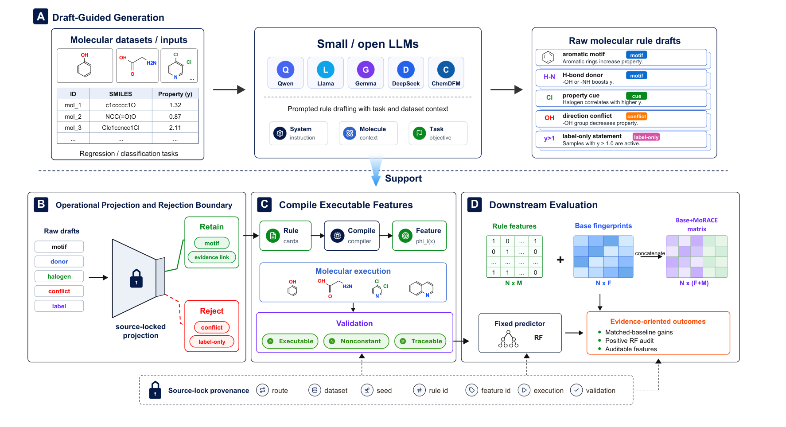

# MoRACE

**Molecular Rule-to-Feature Validation and Compilation Framework for Molecular Property Prediction**

[](https://www.python.org/)
[](LICENSE)

MoRACE converts molecular rules proposed by small open-weight language models into **executable, verifiable and traceable molecular features**. It treats generated rules as candidate drafts, grounds supported operations in a frozen RDKit vocabulary, and connects feature construction to source-linked validation records.

[Method](#method) | [Quick Start](#quick-start) | [Reproduction](#reproduction) | [Documentation](#documentation) | [Citation](#citation)

## Method



*Figure 2 from the accompanying manuscript.*

- **Draft-to-feature validation:** supported rules pass through projection, deterministic compilation, molecular execution and nonconstant-feature checks.
- **An explicit acceptance boundary:** the frozen raw-draft analysis records unsupported, direction-conflicting and task-label-only candidates as rejections.
- **Source-locked provenance:** retained features remain linked to their rules, model routes, datasets and validation records.

MoRACE complements existing molecular representations. Its paired evaluation compares a fixed Morgan feature block with the same block augmented by retained rule features; the compiler does not execute model-written Python.

## Quick Start

Use Python **3.10 or 3.11**. The CPU example needs no model checkpoint or GPU:

```bash
git clone https://github.com/MasterDGL/MoRACE.git
cd MoRACE
python -m pip install -e .
python scripts/verify_repository.py
python examples/compile_rules.py
```

The [example](examples/compile_rules.py) compiles three hand-written rules into molecular features. For programmatic evaluation, see the [Python API](docs/EVALUATION_API.md).

## Reproduction

The paper configuration covers **five model routes, seven datasets and three generation seeds**. Preview the 105-run matrix without loading models or launching jobs:

```bash
python scripts/run_paper_experiments.py
```

Use the [paper reproduction guide](docs/PAPER_REPRODUCTION.md) to supply local checkpoints and route-specific interpreters, preflight the setup, generate rules and audit completed runs. Generation requires Linux/Bash and a compatible model runtime.

After a successful Llama/BBBP run, evaluate its frozen final rules and count-matched controls:

```bash
python scripts/run_feature_experiments.py \
  --dataset bbbp --source artifacts/paper_llama31_native_clean_bbbp_seed42 \
  --seed-profile fifty --output-dir artifacts/paired_bbbp_seed42
```

The generation pipeline's rule-only scores and the paired Morgan+rules results are separate analyses. Exact historical replay requires the corresponding recorded rules, checkpoints and protocol, as described in the reproduction guide.

All seven fixed dataset split sets are included: **BACE, BBBP, ClinTox, HIV, ESOL, FreeSolv and Lipophilicity**. See [data documentation](data/README.md) for endpoints and provenance. Model weights and generated experiment artifacts are not bundled.

## Documentation

- [Paper reproduction](docs/PAPER_REPRODUCTION.md): the manuscript-to-code workflow and required inputs.
- [Paired feature experiments](docs/FEATURE_EXPERIMENTS.md) and [raw-draft closure](docs/RAW_CLOSURE.md): feature evaluation and operational validation.
- [Experiment reports](docs/EXPERIMENT_REPORTS.md), [ECFP baselines](docs/ECFP_BASELINES.md) and [rule contribution](docs/CONTRIBUTION_ANALYSIS.md): evaluation and diagnostics.
- [Run configuration](docs/RUN_CONFIGURATION.md) and [Python API](docs/EVALUATION_API.md): reusable interfaces.
- [Results summary](docs/PAPER_RESULTS.md): a brief qualitative overview.

For development, see [CONTRIBUTING](CONTRIBUTING.md), [versioning](docs/PAPER_VERSION.md), [software verification](docs/ENGINEERING_VALIDATION.md) and [reproducibility](docs/REPRODUCIBILITY.md).

## Citation

Code reference:

```bibtex
@misc{morace_code_2026,
  title = {MoRACE: Molecular Rule-to-Feature Validation and Compilation
           Framework for Molecular Property Prediction},
  year = {2026},
  howpublished = {\url{https://github.com/MasterDGL/MoRACE}},
  note = {Source code}
}
```

Record the exact source commit and resolved protocol when using this code.

## License

Source code is licensed under [Apache-2.0](LICENSE). Dataset and model rights remain with their respective providers.
